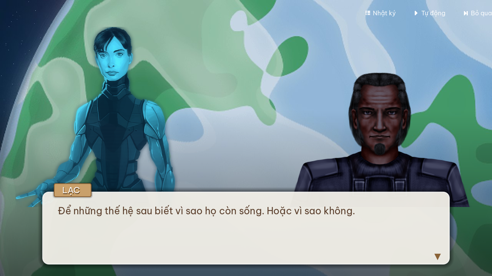
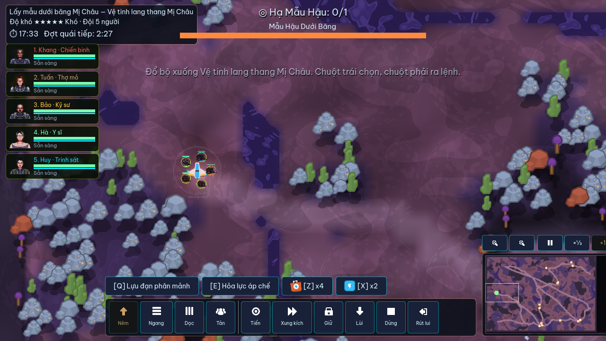
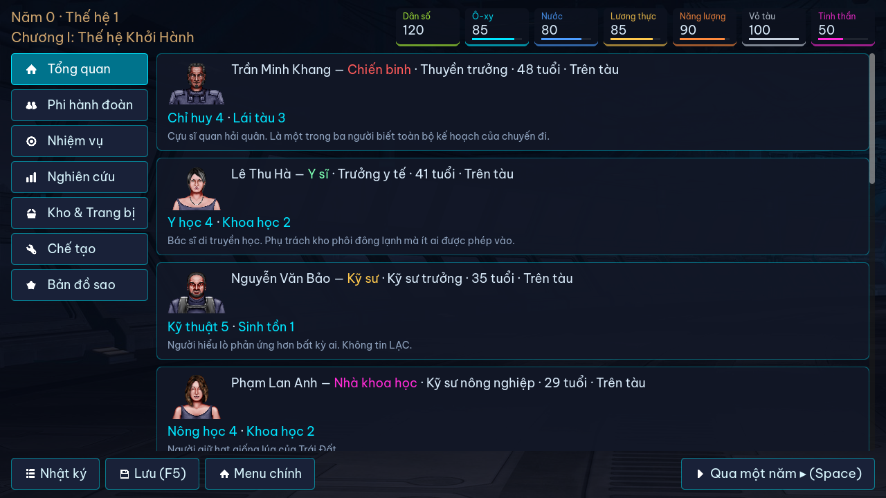

# Âu Cơ: Con Tàu Thế Hệ

Game **chỉ huy đội khai phá 2D top-down (kiểu RTS chiến thuật) + quản lý tàu thế hệ** làm bằng **Godot 4.7**, chạy trên web.
Một con tàu chở 120 người bay 300 năm đến hành tinh Văn Lang. Bạn là chỉ huy: chọn đội 2–6 người theo 6 vai trò
(Chiến binh, Kỹ sư, Thợ mỏ, Y sĩ, Trinh sát, Nhà khoa học), trang bị vũ khí/công cụ, rồi ra lệnh cho họ trên những bản đồ lớn:
**khám phá, chiến đấu với quái và boss, khai thác tài nguyên, giải cứu đồng đội — và rút lui trước khi hết giờ**.

**Điều khiển:** chuột trái chọn/kéo khung · chuột phải ra lệnh theo ngữ cảnh · 1–6 chọn người · thanh lệnh: đội hình (Nêm/Ngang/Dọc/Tản), Tiến, Xung kích, Giữ, Lùi, Dừng, Rút lui · Q/E/R kỹ năng · Z/X vật phẩm · tốc độ ×½/×1/×2 · WASD/mép màn hình/lăn chuột camera · minimap.

> 🎮 Chơi thử: https://tranvanhien2003.github.io/alien-game/ (sau khi bật GitHub Pages, xem bên dưới)

| Dẫn truyện | Bản đồ khai phá Mị Châu | Hub phi hành đoàn |
|---|---|---|
|  |  |  |

## Bắt đầu nhanh

```bash
make setup        # tải Godot 4.7.2 + cấu hình VS Code làm editor ngoài
make run          # chạy game
make test         # chạy toàn bộ test headless
make edit         # mở Godot editor
make assets       # tải lại asset CC0 + sinh atlas/quái ghép + dựng TileSet (cần Python + Pillow)
make help         # xem mọi lệnh
```

Trong VS Code: cài extension được gợi ý (godot-tools), `F5` để chạy/debug, `Ctrl+Shift+P → Run Test Task` để test.

## Cấu trúc

```
data/            Toàn bộ nội dung game (JSON) — sửa ở đây, không cần đụng code
  config/          chỉ số tàu, chỉ số chiến đấu, hằng số cân bằng
  chapters/ events/ dialogues/ endings/     cốt truyện
  characters/ skills/                       phi hành đoàn
  missions/ locations/ levels/              nhiệm vụ, bản đồ sao, tham số sinh màn
  enemies/ abilities/ items/ loot/ recipes/ resource_nodes/   combat & vật phẩm
  tech/                                     cây công nghệ
scripts/
  autoload/        Content (nạp JSON + kiểm tra), Game (trạng thái), SaveManager (save có version)
  systems/         Logic thuần: mô phỏng, sự kiện, crew, nghiên cứu, nhiệm vụ, combat stats, loot, chế tạo
  actors/          Player, Enemy/Boss, đạn, mỏ, đồ rơi, mục tiêu, vùng nguy hiểm
  mission/         Sinh bản đồ thủ tục, điều phối màn action, HUD
  ui/              Màn hình tiêu đề, hub trên tàu
assets/          Đồ họa, âm thanh (sinh bởi tools/import_assets.py — xem assets/CREDITS.md)
  characters/ enemies/ props/ items/ fx/ audio/
  tiles/           atlas autotile theo biome + world_tileset.tres
scenes/          title/, hub/, mission/, actors/
tests/           Test headless (chạy trong CI trước mỗi lần deploy)
tools/           setup.sh, godot.sh, import_assets.py, build_tileset.gd, screenshot
design/          story_bible.md (bí mật cốt truyện), game_design.md
```

## Dẫn truyện

- Sự kiện cốt truyện phát kiểu visual novel (`scripts/ui/story_player.gd`): nền minh họa, chân dung hai bên, chữ hiện dần, Bỏ qua / Tự động / Nhật ký.
- Mọi lời thoại, lựa chọn và sự kiện của tàu được lưu vào **Nhật ký** (`scripts/ui/backlog.gd`, lưu trong save).
- Nội dung: `data/dialogues/*.json` (`bg`, `lines[{speaker, text, side?, bg?}]`) và `data/events/*.json` (`dialogue`, `background`).

## Đồ họa & bản đồ

- **Asset:** chủ yếu CC0 từ [Kenney](https://kenney.nl) (Topdown Shooter, Sci-Fi RTS, Space Shooter, Tower Defense, Generic Items, Monster Builder, Particle Pack, Sci-Fi/Impact Sounds). Danh sách đầy đủ: [assets/CREDITS.md](assets/CREDITS.md).
- **Bản đồ ngoài trời** (sao chổi, mặt trăng, bãi mảnh vỡ): địa hình mở sinh từ noise (`TerrainGenerator`) — đồi, vách đá, rừng, suối/khe băng, đường mòn nối các điểm khám phá — vẽ bằng shader `shaders/terrain.gdshader` (đổ bóng đồi, texture chi tiết, nước gợn).
- **Bản đồ trong tàu** (Âu Cơ, xác tàu): `TileMapLayer` autotile 47 biến thể, va chạm, bóng đổ, lưới tìm đường.
- Chân dung: VegaStrike Portraits + Justin Nichol (CC-BY-SA 3.0); sprite đội có hoạt ảnh: Top Down Survivor (CC-BY 3.0), đổi màu theo vai trò; nền nội thất tàu: CC0.
- **2.5D:** tường có mặt trước, Y-sort giữa nhân vật / tường / đồ vật, ánh sáng 2D + bóng đổ, đèn pin hình nón theo hướng ngắm.
- **5 biome:** tàu Âu Cơ, xác tàu Tiên Phong, bãi mảnh vỡ, sao chổi băng, mặt trăng Mị Châu (chọn qua `data/levels/*.tileset`).
- Muốn đổi asset: sửa bảng ánh xạ trong `tools/import_assets.py` rồi `make assets`. Asset đã sinh được commit sẵn nên CI không cần tải.

## Nguyên tắc dự án

- **Nội dung tách khỏi code**: nhân vật, vật phẩm, vũ khí, quái, boss, sự kiện, nhiệm vụ đều ở `data/`. Modder chỉ cần thêm JSON — xem [MODDING.md](MODDING.md).
- **Save có phiên bản**: `SaveManager.SAVE_VERSION` + chuỗi migration. Đổi cấu trúc save → tăng version, thêm migration, thêm test.
- **Kiểm tra nội dung tự động**: `Content.validate()` bắt mọi tham chiếu id sai; CI sẽ fail nếu có lỗi.
- **Phạm vi nhỏ trước**: Chương I hoàn chỉnh → phát hành itch.io → lấy phản hồi.
- **Story bible**: `design/story_bible.md` là nguồn sự thật cho lore.

## Deploy

**GitHub Pages (tự động):**
1. Push lên nhánh `main` của repo public `TranVanHien2003/alien-game`.
2. Repo → **Settings → Pages → Source: GitHub Actions**.
3. Mỗi lần push: CI tải Godot, chạy test, export Web, deploy. Xem tiến trình ở tab **Actions**.

**Thủ công / itch.io:**
```bash
make setup-templates   # một lần (~1.3 GB, chỉ giữ template Web)
make export-web        # build/web/
make serve             # http://localhost:8000
make itch-zip          # build/au-co-web.zip để upload lên itch.io (chọn "This file will be played in the browser")
```

Bản Web được export **không dùng thread** (chạy được trên GitHub Pages không cần header COOP/COEP) và dùng renderer **Compatibility**.

## Đổi phiên bản Godot

Sửa `.godot-version` → `make setup` (CI tự đọc cùng file này).
